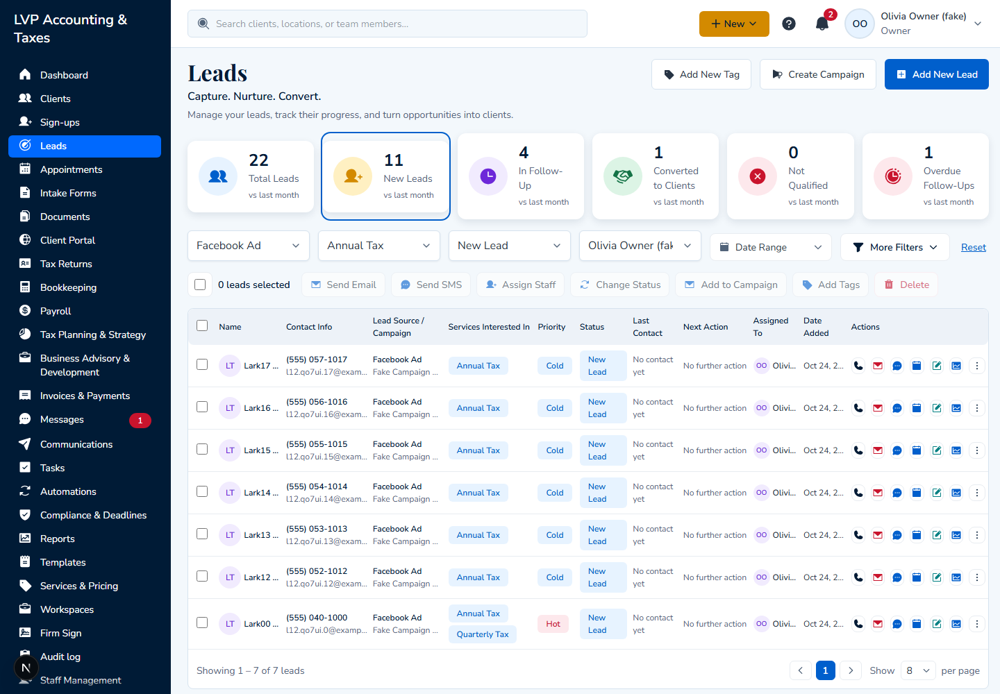
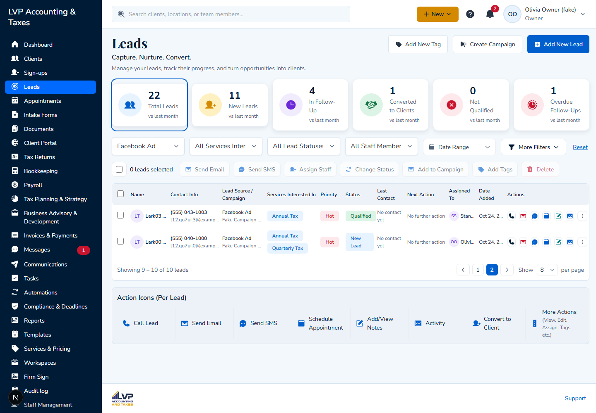
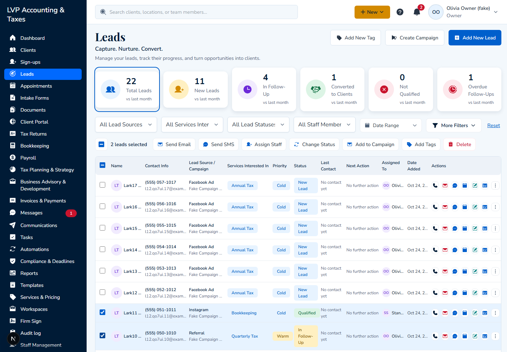
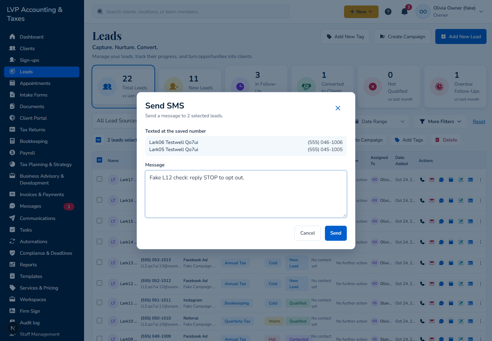
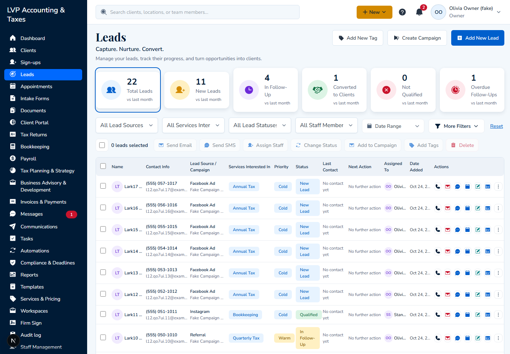
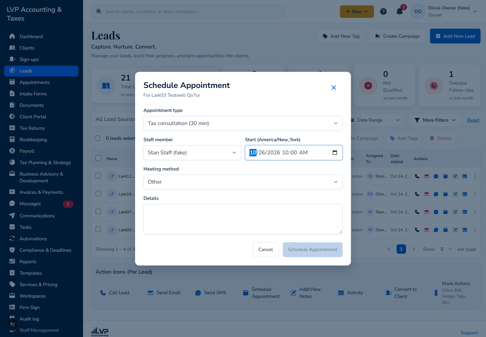
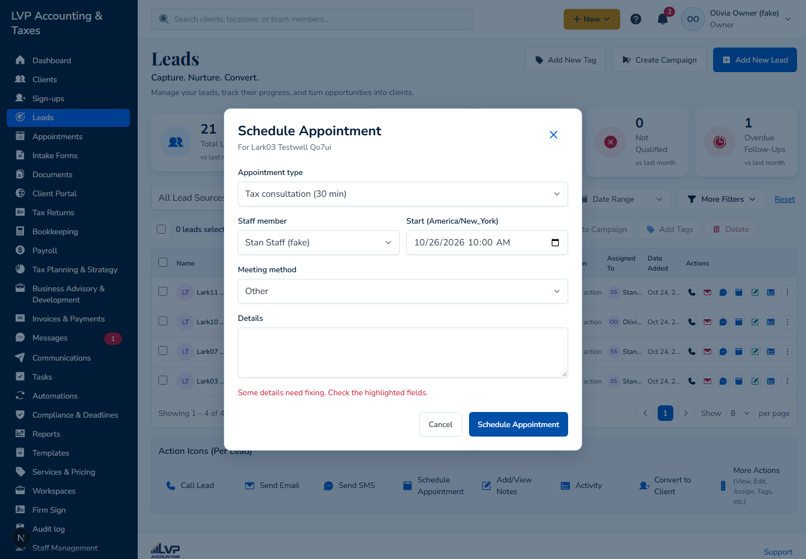

# L12: Leads verification checklist (Octavia's Oct 20 review)

CHANGE-LIST Oct 21, section C, L12. It covers review items 21 (filters), 22 (search and pagination), 23 (bulk actions) and 26 (columns, Schedule Appointment, statuses) of `docs/specs/review-2026-10-21/leads--developer-review-package.md`, checked against the written requirements in `docs/mockups/firm-workspace/leads/source/firmivra-leads-module-developer-instructions-1.docx` and the design `leads.jpg`.

**How it was run:**
- Run on Oct 24, 2026, with `main` at 461830eef (L7 merged; L10 and L11 still open as #1075 and #1078).
- Local API and web, against this worktree's own database, signed in as `owner@lvp.test`, with `SMS_MODE=log`.
- Synthetic data only: 18 leads named `LarkNN Testwell <run>`, with fake emails and 555 numbers, spread over three sources, three services, four statuses and both staff members, plus one note carrying a unique word.
- API checks fetched every page and compared each row with the filter. Screen checks drove the Leads page in Chromium at 1440 px and read the requests it sent.

**Results:**
- **Pass:** filters (alone, combined, Reset); search at the API by name, email, phone, campaign text, notes and source; paging and rows per page keeping filters; every bulk action that exists; statuses; closed and converted leads staying listed.
- **Fail:**
  - there is no search box on the Leads page;
  - searching a full name finds nothing;
  - Schedule Appointment can't book a lead;
  - bulk Convert to Client isn't built.
- **Partial:**
  - the table has 11 of the spec's 12 columns (no Preferred);
  - the appointment dialog prefills the name and staff member, but doesn't show the phone or email.

Result key: **Pass** means it was seen working. **Fail** means it was seen not working, or it's missing. **Partial** means only part of it works. **Blocked** means it can't be tested yet. **Pending** means it's waiting on an open PR.

## Filters (review item 21)

| # | Check | Result | Evidence |
| --- | --- | --- | --- |
| F1 | Source alone | Pass | `source=FACEBOOK_AD`: 4 of the run's 4 Facebook Ad leads, every row Facebook Ad, total 4 = rows 4. |
| F2 | Service alone | Pass | `serviceId=<Quarterly Tax>`: the run's 5 leads with that service, including one where it is the second service; every row has it. |
| F3 | Status alone | Pass | `stage=CONTACTED`: the run's 3 Contacted leads, nothing else. |
| F4 | Staff alone | Pass | `assignedUserId=<Olivia Owner>`: the run's 6 leads assigned to her, every row hers. |
| F5 | Combined | Pass | Source + service (4), source + status (1), status + staff (0, as expected), all four together (1, Lark00), and a combination nobody matches (0). |
| F6 | Combined on screen | Pass | All four selects set: the request carries `source`, `serviceId`, `stage` and `assignedUserId`, and the pager reads "Showing 1 – 7 of 7 leads", which matches the API's total of 7.  |
| F7 | Reset | Pass | The pager reads 21 leads, then 1 with Referral + Contacted, then 21 again after Reset. All four selects are back to "All …". |
| F8 | Counts agree | Pass | With no filter, the list total (16 at that point) equals the Total Leads card (16). |

## Search and pagination (review item 22)

| # | Check | Result | Evidence |
| --- | --- | --- | --- |
| S1 | A search box on the Leads page | **Fail** | The Leads page has no search field. The header search ("Search clients, locations, or team members", `components/app-shell/firm-controls.tsx`) searches clients and team members only. The design has "Search leads by name, email, phone, source…" in the top bar. The API supports `search`, but nothing on screen sends it. |
| S2 | Name | Pass (API) | `search=Lark03` finds Lark03 only. |
| S3 | Email | Pass (API) | Part of an address finds that lead only. |
| S4 | Phone | Pass (API) | `043-1003` finds that lead only. |
| S5 | Campaign | Pass (API) | The "Lead Source / Campaign" text (`Fake Campaign 2 <run>`) finds exactly the 4 leads that have it. Communications campaign names (L7) aren't searched; More Filters > All Campaigns filters by them instead. |
| S6 | Notes | Pass (API) | A word that appears only in one lead's note finds that lead. |
| S7 | Source | Pass (API) | `Instagram` finds the run's 4 Instagram leads by the source label. |
| S8 | No match | Pass (API) | 0 results. |
| S9 | Full name ("Lark03 Testwell") | **Fail** | 0 results. Each field is matched against the whole term, so a first and last name typed together match no single field. |
| S10 | Paging with search | Pass (API) | 12 results at 5 per page come back as 5, 5 and 2, with a total of 12 on each page and 12 distinct leads. With a source filter as well: 4 results at 2 per page, all correct. |
| S11 | Paging keeps the filters (screen) | Pass | With the Facebook Ad filter, page 2 sends `source=FACEBOOK_AD&page=2&pageSize=8`, the select still shows Facebook Ad, and the pager reads "Showing 9 – 10 of 10 leads".  |
| S12 | Rows per page keeps the filters (screen) | Pass | Changing to 16 per page sends `source=FACEBOOK_AD&page=1&pageSize=16`: the filter stays and the page goes back to 1. |
| S13 | Search with paging on screen | Blocked | Needs S1. |

## Bulk actions (review item 23)

The written requirement lists "Email, SMS, assign staff, status, campaign, tags, convert, delete".

| # | Check | Result | Evidence |
| --- | --- | --- | --- |
| B1 | The bulk bar | **Fail** (Convert) | The bar shows Send Email, Send SMS, Assign Staff, Change Status, Add to Campaign, Add Tags and Delete. **Convert to Client isn't there**, and the API has no bulk convert. The design's bulk bar has no Convert either, so the spec and the design differ (see the decisions below).  |
| B2 | Change Status, 2 selected (screen) | Pass | The request sent exactly the two ids. Both became Qualified, and the next lead stayed Contacted. |
| B3 | Assign Staff, 1 selected (screen) | Pass | Lark11 moved to Stan Staff, and Lark10 stayed with Olivia Owner. |
| B4 | Add Tags, 2 selected | Pass | Bulk route: `changed 2, skipped 0`. Both leads have W-2, and the next lead has none. |
| B5 | Add to Campaign, 1 selected | Pass | Bulk route: `changed 1`. The lead shows the campaign, and the next lead shows none. |
| B6 | Send SMS, 2 selected (screen) | Pass | Before sending, the composer lists both names with their saved numbers. After sending it says "Text sent to 2 leads.", both leads have an `SMS_SENT` activity, and an unselected lead has none. Delivery to a real phone still needs the dev number (L2).  |
| B7 | Send Email, 2 selected (screen) | Pass | The composer lists exactly the two saved addresses. Delivery and formatting were checked in L4 (Mailpit). |
| B8 | Delete (the archive), 1 selected (screen) | Pass | The total went from 22 to 21, and only the selected lead left the list. |
| B9 | Delete limited to the Owner and the Admin | Pending | L11, #1078 (unit and e2e tests there). |
| B10 | Bulk conversion, with permission | Blocked | Not built (B1). |

## Columns, statuses and Schedule Appointment (review item 26)

| # | Check | Result | Evidence |
| --- | --- | --- | --- |
| C1 | Table columns | **Partial** | The table has 11 of the spec's 12: Name, Contact Info, Lead Source / Campaign, Services Interested In, Priority, Status, Last Contact, Next Action, Assigned To, Date Added and Actions. **Preferred** (contact method) is missing. The design has no Preferred column either. Each row already carries `preferredContact`, and the lead's Overview shows it.  |
| C2 | Priority, Last Contact, Next Action | Pass | All three columns show values, for example "Hot", "No contact yet" and "No further action". |
| C3 | Statuses | Pass, with notes | The status filter offers New Lead, In Review, Contacted, In Follow-Up, Appointment Scheduled, Qualified, Converted, Not Qualified and No Response. All eight of the spec's statuses are there. Two use the design's shorter labels: "Converted" for "Converted to Client" and "No Response" for "Lost / No Response". "In Review" is Begin Online's review step. |
| C4 | Closed and converted leads aren't deleted | Pass | The Converted filter lists the converted lead, and a lead set to Lost stays listed. Nothing deletes leads; Delete archives them, and L10 (#1075) restores them. |
| C5 | Schedule Appointment: prefill | **Partial** | The dialog shows the lead's name ("For Lark03 Testwell …") and preselects the assigned staff member. It doesn't show the phone or email.  |
| C6 | Schedule Appointment: booking | **Fail** | `POST /business/appointments/schedule` returns 400 "Appointments for leads are not available yet. Convert the lead to a client first." for any lead that isn't converted. The dialog shows only "Some details need fixing. Check the highlighted fields." with nothing highlighted. No appointment is booked, and the status and activity don't change. **Cause:** `appointments.client_id` is required and there's no lead link, so the scheduling API (`appointments/scheduling-write.service.ts`, `clientFor`) refuses leads. Booking a lead needs a schema change.  |

## Follow-ups

Fixes R55 can make, one PR each:
1. **Search on the Leads page (S1, S9).** A search field on the Leads page that keeps the filters and goes back to page 1. At the API, every word of the term must match some field, so a full name works. This is web and leads API work, owned by R55.
2. **Schedule Appointment's error (C6, the screen part).** Show the server's reason instead of "Some details need fixing", and show the lead's phone and email in the dialog (C5).

Needs from others:
- **Schema (R0), for C6:** an appointment for a lead. `appointments.lead_id` (nullable, same business), `client_id` nullable, and a CHECK that exactly one is set. Then the scheduling API books a LEAD contact, moves the lead to Appointment Scheduled and logs the activity. Until then, a lead can only be booked after conversion.

Decisions for Rasel (the spec and the design differ):
- **Bulk Convert to Client (B1):** it's in the written spec but not in the design. Converting several leads at once would need the conversion's choices (client type, services, staff, portal invitation) made once for all of them, or one after another. Should we build it, and if so, which way?
- **Preferred column (C1):** it's in the written spec but not in the design. The data is there already. Should we add the column?
