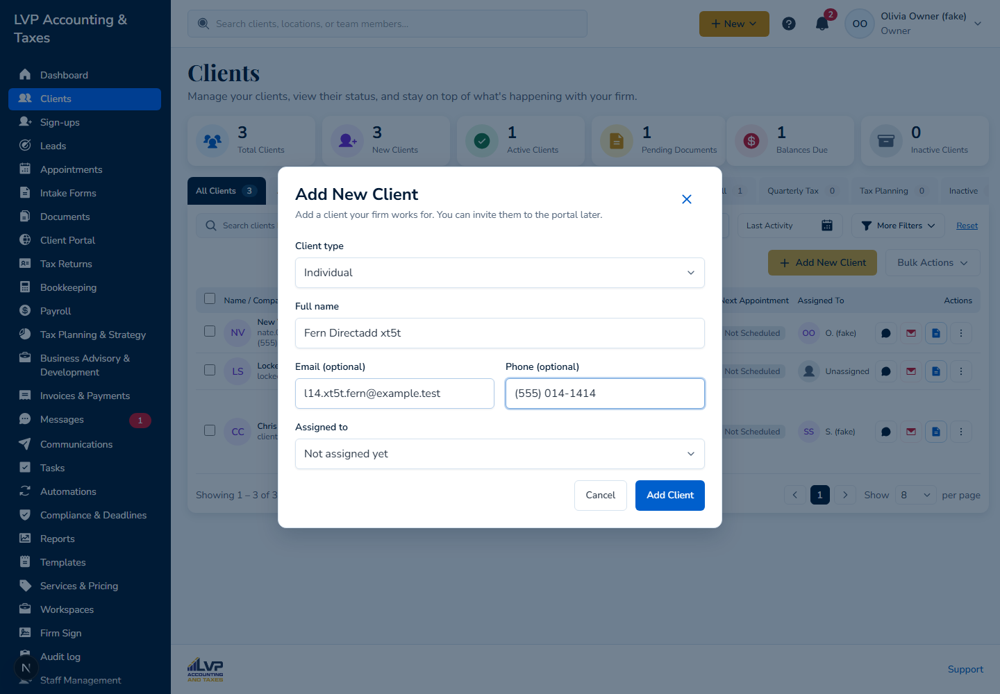
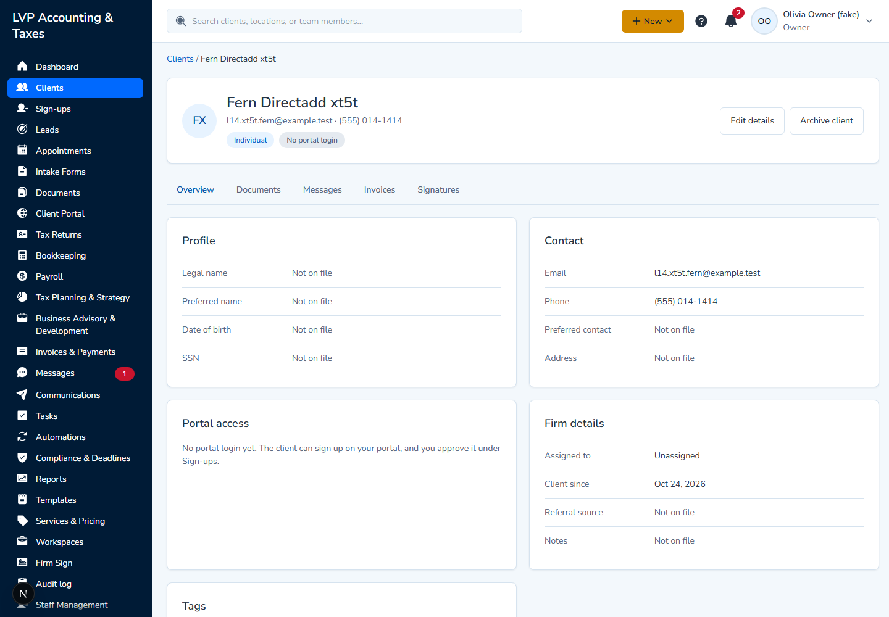
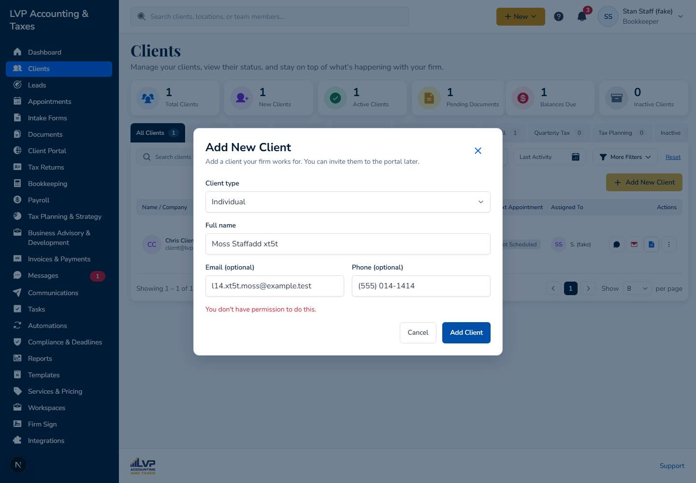

# L14: Creating a client without a lead (Octavia's Oct 20 review)

CHANGE-LIST Oct 21, section C, L14: "Direct client creation without a lead first (she reported it unavailable): carried to the Clients review." Checked on Oct 24, 2026, with `main` at fd9e48c99, on the local API and web, with synthetic data.

## Result: available now

**Add New Client** on Clients creates a client directly; no lead is needed. It arrived on Oct 21 in #978 (the Clients list design), the day after her review, so it wasn't there when she looked.

| Check | Result | Evidence |
| --- | --- | --- |
| As the Owner: Clients > Add New Client | Pass | **Fields:** Client type (Individual or Business), Full name or Business name, Email (optional), Phone (optional), and Assigned to (Owner and Admin only). **Add Client** opens the new client's record, and the client appears in the Clients list. |
| No lead is made | Pass | Searching Leads for the new client's email finds 0. |
| As a Bookkeeper (`staff@lvp.test`), whose permission grid has no Clients create | Refused, correctly | The server answers 403 and the dialog says "You don't have permission to do this.", as the centralized permissions require. |

## Notes

- **The button shows for every role.** The screen doesn't know the member's permission grid, so Staff without Clients create still see Add New Client and are refused when they save. Hiding it would need an endpoint for the signed-in member's own permissions, which doesn't exist yet. Until then, the refusal message is clear.
- **The legal name stays empty.** The Full name typed in the dialog becomes the client's display name only, so the Profile card shows Legal name "Not on file" until someone fills it in with Edit details.
